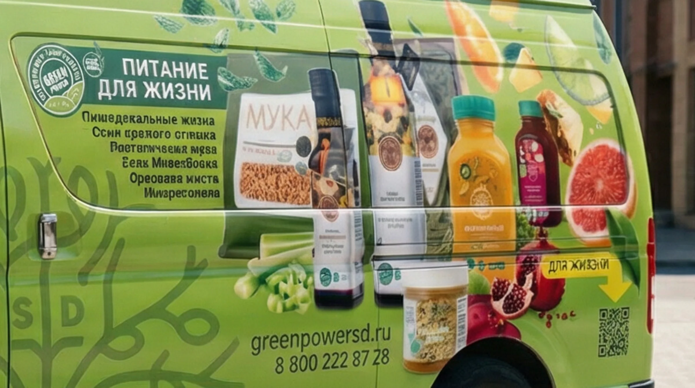
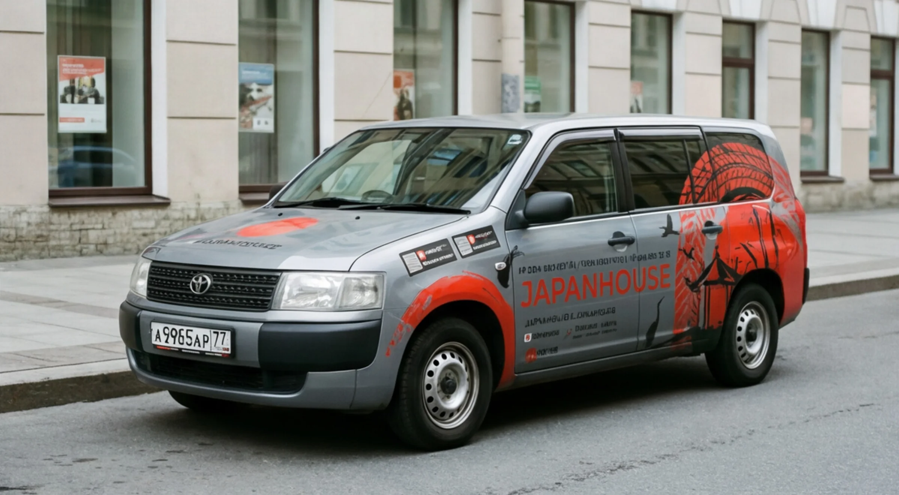

«Реклама на авто» в прайсах выглядит одной услугой. На деле за ней стоят три отдельные работы: дизайнер собирает макет, печатник переносит его на пленку и вырезает детали, оклейщик готовит кузов и клеит. У каждого свой бюджет, свой срок и своя зона ответственности.

Порядок цифр на примере фургона доставки: дизайн — от 10 000 до 25 000 ₽ в зависимости от сложности, печать и резка пленки — около 50 000 ₽, поклейка считается отдельно у мастера по оклейке. Я графический дизайнер, делаю первое звено цепочки. Ниже разберу, как она устроена, на живом проекте, включая собственную ошибку в 50 сантиметров. Она едва не обернулась перепечаткой всего винила.

## Кто участвует в оклейке машины

В объявлениях одна и та же услуга называется по-разному: брендирование авто, оклейка рекламой, изготовление рекламы на автомобиль. За любым названием стоит одна цепочка: заказчик → дизайнер → печатник → оклейщик.

Между звеньями передаются конкретные вещи. Заказчик дает дизайнеру бриф и данные машины. Дизайнер отдает печатнику макет под печать. Печатник отдает оклейщику пленку с вырезанными деталями. Оклейщик возвращает заказчику готовую машину.

Три специалиста могут работать в трех разных компаниях и даже не знать друг друга. Для заказчика такая схема нормальна, пока цепочка собрана заранее и звенья обмениваются информацией. Проблемы начинаются, когда каждый работает вслепую.

## За что вы платите каждому из троих

**Дизайнер** отвечает за то, чтобы машину замечали и понимали. Композиция по кузову, читаемость с расстояния и на скорости, подготовка макета под печать: цвет в CMYK, развертка по деталям кузова, припуски и запас на приладку. Мои пакеты стоят от 10 000 до 25 000 ₽, состав каждого расписан на странице услуги.

**Печатник** превращает файл в материал: пленка, широкоформатная печать, ламинация, плоттерная резка. На фургоне Green Power печать и подготовка пленки стоили порядка 50 000 ₽.

**Оклейщик** доводит работу до кузова: мойка и обезжиривание, перенос пленки, подгонка по месту, стыки и кромки. Цену поклейки в том проекте я не видел: подрядчика привел заказчик, работы шли на его стороне.

По печати и поклейке вместе я обычно называю заказчикам ориентир от 5 000 до 50 000 ₽. Цифру двигают сложность макета, количество пленки и ее качество. Фургон Green Power из этой вилки вышел: одна печать стоила около 50 000 ₽, поклейка шла сверху.

*Результат работы всех трех звеньев: продуктовая витрина на борту фургона вживую*

| Этап | Что получаете | Срок на примере фургона | Бюджет |
|------|---------------|------------------------|--------|
| Дизайн | макет под печать | 3 дня | 10 000–25 000 ₽ |
| Печать и резка | пленка с готовыми деталями | 1 день | около 50 000 ₽ |
| Поклейка | машина на дороге | от нескольких часов до суток | у мастера по оклейке |

Сроки в таблице взяты из живого проекта: столько занял фургон Green Power.

## Что делает дизайн дороже или дешевле

Внутри вилки 10 000–25 000 ₽ цену дизайна двигают две вещи. Сложная графика ее поднимает, несколько машин в одном стиле снижают.

Пример сложной графики: Toyota Probox для Japanhouse, компании, которая привозит машины с японских аукционов. На сером металлике нарисована японская гравюра: красное солнце со следом протектора внутри, журавли, бамбук и пагода. Сейчас такой проект попадает в имиджевый пакет за 25 000 ₽.

По срокам он уложился в неделю. 21 июля заказчик написал и внес предоплату. 27 июля я показал три варианта, 28-го внес правки, заказчик утвердил дизайн, и я отправил макет под печать.

*Японская гравюра на борту Probox: такая графика поднимает цену дизайна до имиджевого пакета*

С автопарком цена идет вниз: за несколько кузовов в одном стиле я делаю скидку за объем. Стиль ищут на первой машине, остальные получают его в адаптации под свой кузов.

У Green Power порядок был тот же, но без скидки. Первым в работу пошел Lexus LX570, и для него мы перебрали много вариантов дизайна. Потом найденный стиль я перенес на остальные легковые машины, а фургон Hiace пришел отдельным заказом позже. Из-за долгого поиска на Лексусе скидку за парк я в том проекте не делал.

## Почему «под ключ» подходит не всем

Все три работы продают и в одном окне: рекламные производства и студии оклейки. Внутри сидят те же три роли, только дизайн там побочная функция при печатном станке. Для задачи «логотип и телефон на белом борту» такого дизайна достаточно, и собирать цепочку из трех подрядчиков нет смысла.

Отдельный дизайнер нужен, когда машина должна работать на бренд: имиджевая оклейка, автопарк в едином стиле, сложная графика. У печатника нет причин думать, как ваш борт прочитается в потоке с тридцати метров. Дизайнер за такие вещи и берет деньги.

## Как цепочка выглядела вживую: фургон Green Power

Green Power развозит продукты для здорового питания. Заказчик пришел с готовым условием: оклейщик у него свой, машины сначала полностью затягиваются в фирменный светло-зеленый, поверх идет графика. Мне оставалось звено дизайна: знак-дерево, орнамент из веток и продуктовая витрина на бортах Toyota Hiace.

Дальше цепочка отработала по звеньям. Я сделал макет за три дня и отправил печатнику. Тот за день напечатал, перенес на пленку, вырезал детали и отвез их оклейщику заказчика. Готовую машину я увидел уже в работе.

*Тот самый макет под печать: развертка графики по деталям кузова Hiace, в таком виде файл уходит печатнику*

Порядок здесь главное: условия оклейщика я знал до того, как открыл графический редактор. Цепочку собрали до старта, каждый знал, что от него ждут. Живой контакт между звеньями вскоре выручил и меня.

## Моя ошибка в 50 сантиметров

Сроки были сжатые, и размеры кузова я взял из документов: модель и год из свидетельства о регистрации. С легковыми машинами такой способ работает: я спрашиваю модель, год, особенности вроде рестайлинга, и этого хватает. С коммерческим транспортом способ не сработал: у Hiace десятки модификаций, они отличаются длиной, шириной и высотой. Я сделал макет на 50 сантиметров длиннее реальной машины.

Ошибка вскрылась на последнем звене, когда оклейщик начал примерять пленку к кузову. Худший сценарий: переделка макета, перепечатка всего винила и счет примерно на те же 50 тысяч, который по справедливости оплатил бы я из своих.

Спас мастер оклейки: сумел подрезать и подогнать детали по месту, машина ушла в срок. Я в качестве извинений не взял оплату за дизайн макета. Урок обошелся в стоимость моей работы, хотя мог стоить вдвое дороже.

Что я изменил в процессе после того проекта:

- для коммерческого транспорта прошу обмер конкретной машины или фото с рулеткой, документам с моделью и годом больше не доверяю;
- сверяю габариты макета с печатником до отправки в печать;
- закладываю в макет запас на приладку;
- прошу оклейщика посмотреть макет до печати.

Все четыре пункта бесплатные и укладываются в день переписки, а страхуют от счета на десятки тысяч.

## Чек-лист заказчику: собираем цепочку без потерь

1. Найдите оклейщика раньше дизайнера: у него требования к пленке, стыкам и порядку работ.
2. Дайте дизайнеру точную модификацию машины, лучше — обмер или фото с рулеткой.
3. Убедитесь, что получаете макет под печать: CMYK, развертка по деталям, припуски. Красивая картинка для согласования печатнику не подходит.
4. Познакомьте дизайнера и печатника напрямую, чтобы технические вопросы решались без вашего пересказа.
5. До печати договоритесь, кто проверяет размеры и кто платит за ошибку.
